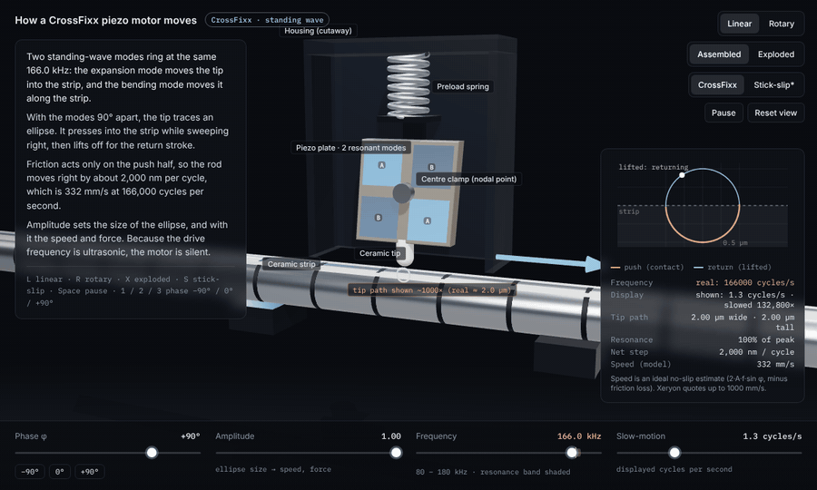

# CrossFixx piezo motor explainer

**[Open the live explainer](https://xinirnix.github.io/crossfixx-explainer/)**



The phase between the two vibration modes sets the direction: +90° drives the rod right, 0° gives no net motion, −90° reverses it. The rotary version is the same motor driving a rotor. In exploded view the tip still vibrates, but with no contact nothing moves.

Interactive 3D explainer of a two-mode standing-wave ultrasonic piezo motor (Xeryon CrossFixx style).

```
npm install
npm run dev      # http://localhost:5173
npm run build    # static site in dist/
```

Every push to `main` builds and deploys the site to GitHub Pages (`.github/workflows/pages.yml`).

## Files

- `index.html`: the page and HUD markup
- `src/physics.js`: tip equation `x = A·sin(ωt)`, `y = A·sin(ωt + φ)`, resonance, net step per cycle, stick-slip contrast. Constants (166 kHz, Q, 1 µm, 1000× exaggeration) are at the top.
- `src/scene.js`: primitive geometry (piezo plate, electrodes, tip, spring, housing, strip, rod, rotor), labels, ghost ellipse, sparks
- `src/main.js`: state, animation loop, controls, keyboard
- `src/captions.js`: the sentences in the left panel
- `src/inset.js`: the real-scale tip path chart
- `src/style.css`: HUD styling

Keys: L linear, R rotary, X exploded, S stick-slip, Space pause, 1/2/3 phase −90/0/+90.
